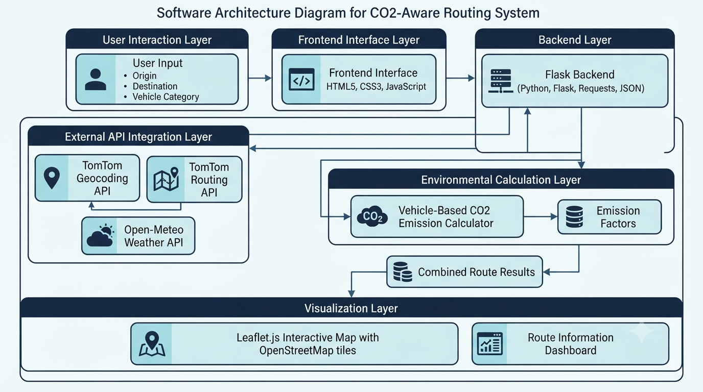

# 🌍 Smart Route Planner with Wind & Emission Insights

<p align="center">
  <strong>Intelligent Route Planning • Environmental Impact Estimation • Weather Insights</strong>
</p>

<p align="center">
  
  
  
  
  
  
</p>

---

## 📌 Project Overview

**Smart Route Planner with Wind & Emission Insights** is a web-based route planning application designed to combine geographical navigation, vehicle-based carbon emission estimation, and destination weather information into a unified interface.

Traditional route planners primarily focus on distance and travel duration. This project extends basic route planning by incorporating estimated CO₂ emissions based on vehicle categories and wind-speed information retrieved from weather services.

The application integrates the **TomTom Geocoding API**, **TomTom Routing API**, and **Open-Meteo Weather API**, while **Leaflet.js and OpenStreetMap** provide interactive geographical visualization.

By bringing routing, environmental estimation, and weather information together, the system provides users with additional insights into their journeys.

---

## 🎯 Problem Statement

Conventional route planning systems primarily concentrate on finding routes between two locations. However, users may also need information about the environmental impact and weather conditions associated with their journeys.

Some of the challenges include:

1. **Limited Environmental Awareness:** Users may not have immediate access to estimated CO₂ emissions associated with different vehicle categories.
2. **Fragmented Information:** Route details and weather information are often accessed through separate services.
3. **Vehicle-Dependent Emissions:** Different vehicle categories have different estimated emission factors.
4. **Geographical Interpretation:** Route information is easier to understand when represented visually on an interactive map.

### 💡 Proposed Solution

The Smart Route Planner integrates location geocoding, route calculation, vehicle-based CO₂ estimation, and destination wind-speed information into a single web application.

The system accepts origin and destination locations, identifies their geographical coordinates, retrieves route information, estimates emissions based on the selected vehicle, and displays destination wind-speed information alongside the route visualization.

---

## 🌟 Key Features

### 1. 📍 Location Geocoding
- Accepts origin and destination locations.
- Converts location names into geographical coordinates.
- Uses the TomTom Geocoding API.
- Retrieves latitude and longitude for route calculation.

### 2. 🗺️ Route Calculation
- Integrates the TomTom Routing API.
- Requests the fastest available route.
- Enables traffic consideration in the routing request.
- Retrieves route distance and estimated travel duration.
- Extracts geographical coordinates for map visualization.

### 3. 🌱 Vehicle-Based CO₂ Emission Estimation
- Estimates carbon emissions based on journey distance.
- Supports five vehicle categories.
- Applies different emission factors according to the selected vehicle.
- Provides an estimated carbon footprint for the calculated route.

Emission Calculation Formula:

The estimated CO₂ emission is calculated using:

$$
\boxed{E = D \times F_v}
$$

Where:

$E$ = Estimated CO₂ emissions (grams)

$D$ = Route distance (kilometres)

$F_v$ = Vehicle-specific emission factor (grams/km)

**Configured Vehicle Emission Factors:**

| Vehicle Category | Emission Factor |
|---|---:|
| Car | 120 g/km |
| Truck | 250 g/km |
| Bus | 80 g/km |
| Motorcycle | 90 g/km |
| Bike | 0 g/km |

*Note: These are predefined estimation factors used by the application, not actual measured vehicle emissions.*

### 4. 🌬️ Destination Wind-Speed Insights
- Integrates the Open-Meteo Weather API.
- Retrieves current weather information using destination coordinates.
- Extracts wind-speed information.
- Displays wind-speed information alongside route results.

### 5. 🧭 Interactive Map Visualization
- Uses Leaflet.js for geographical visualization.
- Integrates OpenStreetMap tiles.
- Displays the calculated route using geographical coordinates.
- Draws the route using a map polyline.
- Automatically adjusts the map view to fit the displayed route.

### 6. 💻 Simple User Interface
- Origin and destination input fields.
- Vehicle category selection.
- Route calculation through a simple interface.
- Displays route distance, estimated travel time, CO₂ emissions, and wind speed.
- Presents route results alongside an interactive map.

---

## 🏗️ System Architecture

<p align="center">
  
</p>

The system follows a modular architecture consisting of six major layers:

| Layer | Responsibility |
|---|---|
| User Interaction Layer | Collects origin, destination, and vehicle category |
| Frontend Interface Layer | Handles user input, form submission, and result presentation |
| Backend Layer | Processes requests using Python and Flask |
| External API Integration Layer | Connects TomTom Geocoding, TomTom Routing, and Open-Meteo |
| Environmental Calculation Layer | Estimates CO₂ emissions using predefined vehicle factors |
| Visualization Layer | Displays route geometry and route information using Leaflet.js |

### System Workflow

1. The user enters the starting location and destination.
2. The user selects a vehicle category.
3. The frontend sends the information to the Flask backend.
4. The backend retrieves origin and destination coordinates using TomTom Geocoding.
5. The TomTom Routing API calculates the fastest route with traffic consideration enabled.
6. The application retrieves route distance, travel duration, and geographical route coordinates.
7. The emission calculator estimates CO₂ emissions using the selected vehicle's emission factor.
8. Open-Meteo retrieves wind-speed information for the destination coordinates.
9. The backend combines the results into a JSON response.
10. The frontend displays route information and visualizes the calculated route using Leaflet.js.

---

## 🛠️ Technology Stack

| Category | Technologies |
|---|---|
| Programming Language | Python |
| Backend Framework | Flask |
| Frontend | HTML5, CSS3, JavaScript |
| Geocoding | TomTom Search API |
| Route Calculation | TomTom Routing API |
| Weather Information | Open-Meteo API |
| Map Visualization | Leaflet.js |
| Map Data | OpenStreetMap |
| HTTP Requests | Python Requests |
| Data Exchange | JSON |

---

## 📁 Project Structure

```text
Smart-Route-Planner-with-Wind-Emission-Insights/
│
├── Backend                  # Flask backend source code
│
├── Frontend                 # HTML, CSS and JavaScript frontend
│
├── System_Architecture.png  # Software architecture diagram
│
└── README.md                # Project documentation
```

### Core Components

| Component | Description |
|---|---|
| Backend | Handles API integrations, geocoding, route calculation, and emission estimation |
| Frontend | Provides location inputs, vehicle selection, and route visualization |
| System Architecture | Represents the application's architectural design |
| README | Contains project overview, technical documentation, and setup instructions |

---

## ⚙️ Installation & Setup

### Prerequisites

- Python 3.x
- pip package manager
- Git
- TomTom API key
- Internet connection

### 1. Clone the Repository

```bash
git clone https://github.com/NShiddharth/Smart-Route-Planner-with-Wind-Emission-Insights.git

cd Smart-Route-Planner-with-Wind-Emission-Insights
```

### 2. Organize the Flask Application

The uploaded repository currently contains the backend and frontend as extensionless files.

For the standard Flask structure, organize them as follows:

```text
Smart-Route-Planner-with-Wind-Emission-Insights/
│
├── app.py
├── templates/
│   └── index.html
├── System_Architecture.png
└── README.md
```

- Rename `Backend` to `app.py`.
- Create a `templates` directory.
- Rename `Frontend` to `index.html` and place it inside `templates`.

This structure matches the Flask `render_template("index.html")` call in the backend.

### 3. Create a Virtual Environment

**Windows:**

```bash
python -m venv venv

venv\Scripts\activate
```

**Linux / macOS:**

```bash
python3 -m venv venv

source venv/bin/activate
```

### 4. Install Dependencies

```bash
pip install flask requests python-dotenv
```

`python-dotenv` is required if you apply the environment-variable configuration described below.

### 5. Configure TomTom API Credentials

For security, replace the hardcoded API key in the backend with an environment variable.

Create a `.env` file:

```env
TOMTOM_API_KEY=your_tomtom_api_key
```

Update the backend configuration:

```python
import os
from dotenv import load_dotenv

load_dotenv()

TOMTOM_API_KEY = os.getenv("TOMTOM_API_KEY")
```

Add the following to `.gitignore`:

```text
.env
venv/
__pycache__/
*.pyc
```

Never commit API credentials to a public repository.

### 6. Run the Application

```bash
python app.py
```

Open the application in your browser:

```text
http://127.0.0.1:5000/
```

---

## 🔌 API Integration

### 1. TomTom Geocoding API

**Purpose:** Converts location names into geographical coordinates.

The backend uses the TomTom Search API to retrieve:

- Latitude
- Longitude
- Geographical position of the requested location

Documentation: https://developer.tomtom.com/

### 2. TomTom Routing API

**Purpose:** Calculates the route between the origin and destination.

The application requests:

- Fastest route type
- Traffic consideration enabled
- Route distance
- Estimated travel time
- Route geographical coordinates

Documentation: https://developer.tomtom.com/routing-api/documentation/routing/calculate-route

### 3. Open-Meteo Weather API

**Purpose:** Retrieves wind-speed information at the destination.

The application sends destination latitude and longitude to the weather service and retrieves the current wind-speed value.

Documentation: https://open-meteo.com/

### 4. Leaflet.js and OpenStreetMap

**Purpose:** Provides interactive map visualization.

- Leaflet.js renders the interactive map.
- OpenStreetMap provides map tiles.
- Route coordinates are displayed as a polyline.
- Map bounds are automatically adjusted to fit the route.

Documentation:

- https://leafletjs.com/
- https://www.openstreetmap.org/

---

## 🔗 API Endpoints

The Flask backend exposes two application endpoints.

### 1. Homepage

| Property | Value |
|---|---|
| Method | GET |
| Endpoint | `/` |
| Description | Loads the main web application |

### 2. Route Calculation

| Property | Value |
|---|---|
| Method | POST |
| Endpoint | `/route` |
| Content Type | `application/x-www-form-urlencoded` |
| Description | Calculates route details and environmental insights |

**Request Parameters:**

| Parameter | Description |
|---|---|
| `origin` | Starting location |
| `destination` | Destination location |
| `vehicleType` | Selected vehicle category |

**Supported Vehicle Categories:**

```text
car
truck
bus
motorcycle
bike
```

**Example JSON Response:**

```json
{
  "success": true,
  "routes": [
    {
      "distance": 10.5,
      "travel_time": 15.2,
      "polyline": [
        [13.0827, 80.2707],
        [13.0900, 80.2800]
      ],
      "emissions": 1260.0,
      "wind_speed": 5.2
    }
  ]
}
```

*The response values above are illustrative examples, not measured application results.*

---

## 🔬 Environmental Calculation Methodology

The project incorporates a straightforward vehicle-based emission estimation approach.

### Distance-Based Emission Estimation

The route distance obtained from the TomTom Routing API is converted into kilometres.

The selected vehicle category determines the emission factor.

The application calculates:

\[
\text{CO}_2 = \text{Distance} \times \text{Emission Factor}
\]

For example, considering a hypothetical 10.5 km journey using the configured car emission factor:

\[
10.5 \times 120 = 1260 \text{ g CO}_2
\]

The resulting value represents an estimated carbon emission for the journey.

### Wind-Speed Retrieval

The destination coordinates are passed to Open-Meteo.

The weather API returns the current wind-speed information associated with the destination.

**Important:** Wind speed is currently retrieved at the destination only. It is not used as a routing optimization parameter.

---

## ⚠️ Limitations & Technical Considerations

1. **Emission Estimation:** Uses predefined emission factors rather than actual vehicle fuel consumption, engine characteristics, or measured emissions.
2. **Destination-Based Weather:** Retrieves wind-speed information for the destination instead of evaluating conditions throughout the route.
3. **No Wind-Based Route Optimization:** Wind speed is displayed as additional information and does not currently influence route selection.
4. **External API Dependency:** Route calculation and geocoding depend on TomTom API availability and valid credentials.
5. **Weather Data Dependency:** Wind-speed information depends on Open-Meteo service availability.
6. **Emission Accuracy:** Actual emissions may vary depending on vehicle condition, fuel type, traffic, driving behaviour, and operating conditions.
7. **Wind-Speed Units:** The current frontend labels wind speed as m/s, while the API request does not explicitly set the requested unit. Configure the API's wind-speed unit and ensure the frontend label matches the returned value.

---

## 🚀 Future Enhancements

The following features can extend the current implementation:

1. **Alternative Route Comparison:** Compare multiple route alternatives based on distance, travel duration, and estimated CO₂ emissions.
2. **Wind-Aware Route Analysis:** Evaluate wind conditions along route segments to provide additional environmental insights.
3. **Advanced Emission Models:** Incorporate fuel consumption, vehicle specifications, and operating conditions for more detailed estimates.
4. **Weather Visualization:** Display additional weather parameters along the selected route.
5. **Traffic Visualization:** Integrate additional traffic information into the interactive map.
6. **Environmental Analytics Dashboard:** Introduce graphical comparisons of distance, travel duration, and estimated emissions.
7. **Improved API Security:** Implement environment-based configuration and secure credential management.

---

## 📚 References & Documentation

- [TomTom Developer Portal](https://developer.tomtom.com/)
- [TomTom Geocoding API](https://developer.tomtom.com/search-api/documentation/search-service/geocode)
- [TomTom Routing API](https://developer.tomtom.com/routing-api/documentation/routing/calculate-route)
- [Open-Meteo Weather API](https://open-meteo.com/)
- [Flask Documentation](https://flask.palletsprojects.com/)
- [Leaflet.js Documentation](https://leafletjs.com/)
- [OpenStreetMap](https://www.openstreetmap.org/)

---
