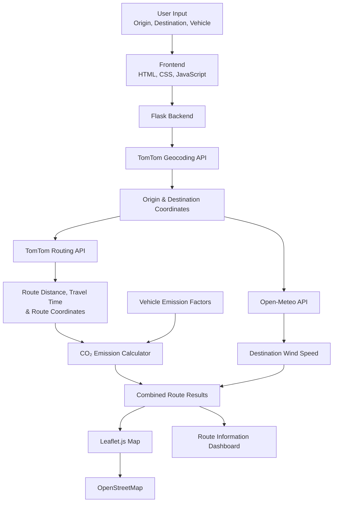

# 🌍 Smart Route Planner with Wind & Emission Insights

<p align="center">
  <strong>Intelligent Route Planning • Environmental Impact Estimation • Weather Insights</strong>
</p>

<p align="center">
  
  
  
  
  
  
</p>

---

## 🌐 Project Overview

**Smart Route Planner with Wind & Emission Insights** is a web-based route planning application that combines geographical routing, vehicle-specific carbon emission estimation, and destination weather information into a single interface.

Unlike basic route planners that primarily display distance and travel duration, this application provides additional environmental insights to help users understand the estimated carbon footprint of their journeys and the wind conditions at their destination.

The application integrates the **TomTom Routing and Geocoding APIs** with the **Open-Meteo Weather API**, while Leaflet.js provides interactive geographical route visualization.

---

## 🎯 Problem Statement

Traditional route planning applications primarily focus on identifying routes and estimating travel duration. However, understanding the environmental impact and weather conditions associated with a journey is also important.

Some of the challenges include:

1. **Limited Environmental Awareness:** Users may not know the estimated CO₂ emissions associated with their selected vehicle and journey distance.
2. **Fragmented Information:** Route information and weather conditions are often presented separately.
3. **Vehicle-Dependent Emissions:** Different vehicle categories have different estimated emission factors.
4. **Lack of Geographical Visualization:** Route information is more difficult to interpret without an interactive map.

### Our Solution

The Smart Route Planner integrates route calculation, estimated emission analysis, and destination wind-speed information into one web application.

---

## 🌟 Key Features

### 1. 📍 Location Geocoding
- Accepts origin and destination locations.
- Converts location names into geographical coordinates.
- Uses the TomTom Geocoding API.
- Retrieves latitude and longitude for route calculation.

### 2. 🗺️ Intelligent Route Calculation
- Integrates the TomTom Routing API.
- Requests the fastest available route with traffic consideration enabled.
- Retrieves route distance and estimated travel duration.
- Extracts geographical coordinates for route visualization.

### 3. 🌱 Vehicle-Based CO₂ Emission Estimation
- Estimates carbon emissions based on route distance.
- Supports five vehicle categories:
  - Car
  - Truck
  - Bus
  - Motorcycle
  - Bike
- Applies different emission factors according to the selected vehicle type.

**Emission Calculation:**

\[
E = D \times F_v
\]

Where:

- \(E\) = Estimated CO₂ emissions (grams)
- \(D\) = Route distance (kilometres)
- \(F_v\) = Vehicle-specific emission factor (grams/km)

**Configured emission factors:**

| Vehicle | Emission Factor |
|---|---:|
| Car | 120 g/km |
| Truck | 250 g/km |
| Bus | 80 g/km |
| Motorcycle | 90 g/km |
| Bike | 0 g/km |

*These are configured estimation factors, not real-time measured vehicle emissions.*

### 4. 🌬️ Destination Wind-Speed Insights
- Retrieves current weather information using Open-Meteo.
- Uses destination latitude and longitude.
- Extracts the reported wind-speed value.
- Displays wind information alongside route results.

### 5. 🧭 Interactive Route Visualization
- Uses Leaflet.js for geographical visualization.
- Displays OpenStreetMap tiles.
- Draws the calculated route using geographical coordinates.
- Automatically adjusts the map view to fit the route.

### 6. 💻 User-Friendly Interface
- Origin and destination input fields.
- Vehicle category selection.
- Route calculation through a simple interface.
- Displays distance, travel time, emissions, and wind speed.

---

## 🏗️ System Architecture

The application follows a lightweight client-server architecture using Flask as the backend and HTML, CSS, and JavaScript as the frontend.



### System Workflow

1. The user enters the starting and destination locations.
2. The user selects a vehicle category.
3. The frontend sends the input to the Flask backend.
4. The backend retrieves geographical coordinates through TomTom Geocoding.
5. The TomTom Routing API calculates the fastest route with traffic consideration enabled.
6. The application extracts route distance, travel duration, and route coordinates.
7. The emission calculator estimates CO₂ emissions using the selected vehicle's emission factor.
8. Open-Meteo retrieves wind-speed information at the destination.
9. The backend combines the results into a JSON response.
10. The frontend displays route information and visualizes the route using Leaflet.js.

---

## 🛠️ Technology Stack

| Category | Technologies |
|---|---|
| Programming Language | Python |
| Backend Framework | Flask |
| Frontend | HTML5, CSS3, JavaScript |
| Geocoding | TomTom Search API |
| Route Calculation | TomTom Routing API |
| Weather Information | Open-Meteo API |
| Map Visualization | Leaflet.js |
| Map Tiles | OpenStreetMap |
| HTTP Requests | Python Requests |
| Data Exchange | JSON |

---

## 📁 Project Structure

Recommended Flask-compatible project structure:

```text
Smart-Route-Planner-with-Wind-Emission-Insights/
│
├── Backend/
│   └── app.py
│
├── templates/
│   └── index.html
│
├── .env
├── .gitignore
├── requirements.txt
└── README.md
```

| File | Responsibility |
|---|---|
| `Backend/app.py` | Flask application, API integrations, routing and emission calculations |
| `templates/index.html` | Frontend interface, form handling and interactive map |
| `.env` | Local API key configuration |
| `.gitignore` | Excludes sensitive files and unnecessary generated files |
| `requirements.txt` | Python dependency management |
| `README.md` | Project documentation |

---

## ⚙️ Installation & Setup

### Prerequisites

- Python 3.x
- pip
- Git
- TomTom API key
- Internet connection for external API requests

### 1. Clone the Repository

```bash
git clone https://github.com/NShiddharth/Smart-Route-Planner-with-Wind-Emission-Insights.git

cd Smart-Route-Planner-with-Wind-Emission-Insights
```

### 2. Create a Virtual Environment

**Windows:**

```bash
python -m venv venv

venv\Scripts\activate
```

**Linux / macOS:**

```bash
python3 -m venv venv

source venv/bin/activate
```

### 3. Install Dependencies

```bash
pip install flask requests python-dotenv
```

### 4. Configure API Credentials

Create a `.env` file in the project root:

```env
TOMTOM_API_KEY=your_new_tomtom_api_key
```

In the backend, load the environment variable instead of hardcoding the API key:

```python
import os
from dotenv import load_dotenv

load_dotenv()

TOMTOM_API_KEY = os.getenv("TOMTOM_API_KEY")
```

Make sure `.env` is included in `.gitignore`.

### 5. Run the Application

After organizing the backend and frontend files into the recommended Flask structure:

```bash
python Backend/app.py
```

Open your browser:

```text
http://127.0.0.1:5000/
```

---

## 🔌 API Reference

### 1. Homepage

| Property | Value |
|---|---|
| Method | GET |
| Endpoint | `/` |
| Description | Loads the main web application |

### 2. Route Calculation

| Property | Value |
|---|---|
| Method | POST |
| Endpoint | `/route` |
| Content Type | Form URL Encoded |

**Request Parameters:**

| Parameter | Description |
|---|---|
| `origin` | Starting location |
| `destination` | Destination location |
| `vehicleType` | Selected vehicle category |

**Supported Vehicle Values:**

```text
car
truck
bus
motorcycle
bike
```

**Example Response:**

```json
{
  "success": true,
  "routes": [
    {
      "distance": 10.5,
      "travel_time": 15.2,
      "polyline": [
        [13.0827, 80.2707],
        [13.0900, 80.2800]
      ],
      "emissions": 1260.0,
      "wind_speed": 5.2
    }
  ]
}
```

*Illustrative response structure; the numerical values are examples.*

---

## 🔄 External API Integrations

### TomTom API

Used for two major operations:

- **Geocoding:** Converts location names into latitude and longitude.
- **Routing:** Calculates the fastest route and retrieves distance, travel time, and route geometry.

Documentation: https://developer.tomtom.com/

### Open-Meteo API

Used to retrieve current destination weather information, specifically wind speed.

Documentation: https://open-meteo.com/

### Leaflet.js & OpenStreetMap

Used for geographical route visualization and interactive map rendering.

- Leaflet: https://leafletjs.com/
- OpenStreetMap: https://www.openstreetmap.org/

---

## ⚠️ Limitations & Technical Considerations

1. **Emission Estimation:** CO₂ calculations use predefined vehicle-specific emission factors rather than actual vehicle telemetry or measured emissions.
2. **Destination-Based Weather:** Wind speed is retrieved for the destination location, not for every segment of the journey.
3. **External API Dependency:** Geocoding and routing depend on TomTom API availability and valid credentials.
4. **Weather Data Availability:** Weather information depends on the availability of Open-Meteo responses.
5. **Route Selection:** The current implementation requests the fastest route with traffic consideration enabled; it does not optimize routes using wind speed or emissions.
6. **Wind-Speed Units:** Configure the Open-Meteo `wind_speed_unit` parameter explicitly and ensure the frontend displays the correct unit.

---

## 🚀 Future Enhancements

Potential improvements include:

1. **Multi-Route Environmental Comparison:** Compare alternative routes based on distance, travel time, and estimated emissions.
2. **Wind-Aware Route Analysis:** Evaluate wind conditions along different route segments.
3. **Advanced Emission Models:** Incorporate vehicle-specific fuel consumption, engine characteristics, and operating conditions.
4. **Weather Visualization:** Display additional weather parameters along the selected route.
5. **Live Traffic Visualization:** Provide additional traffic information on the interactive map.
6. **Route Analytics Dashboard:** Introduce graphical comparisons of distance, travel time, and estimated carbon emissions.
7. **Secure API Configuration:** Improve credential management through environment variables and centralized configuration.

---

## 👨‍💻 Author

**N Shiddharth**

GitHub: [@NShiddharth](https://github.com/NShiddharth)

Project Repository: [Smart Route Planner with Wind & Emission Insights](https://github.com/NShiddharth/Smart-Route-Planner-with-Wind-Emission-Insights)

---

<p align="center">
  <strong>Building smarter journeys with route intelligence and environmental awareness. 🌍</strong>
</p>
